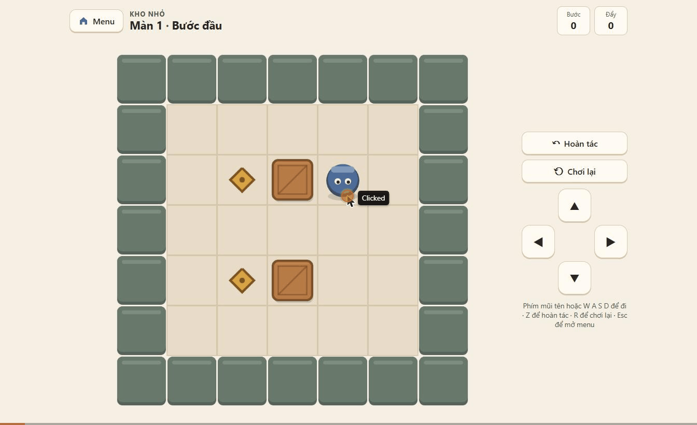
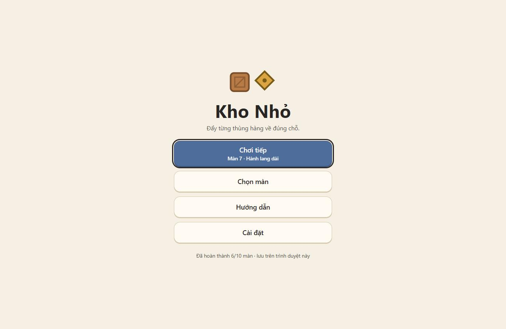
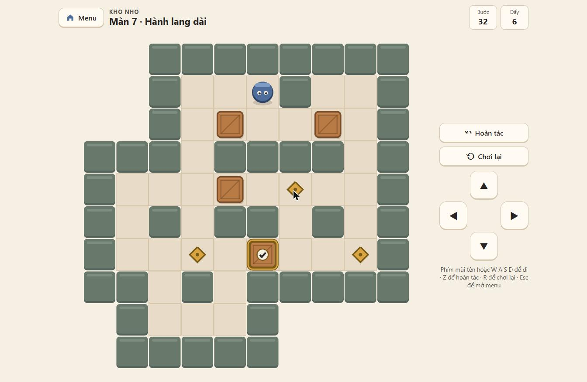
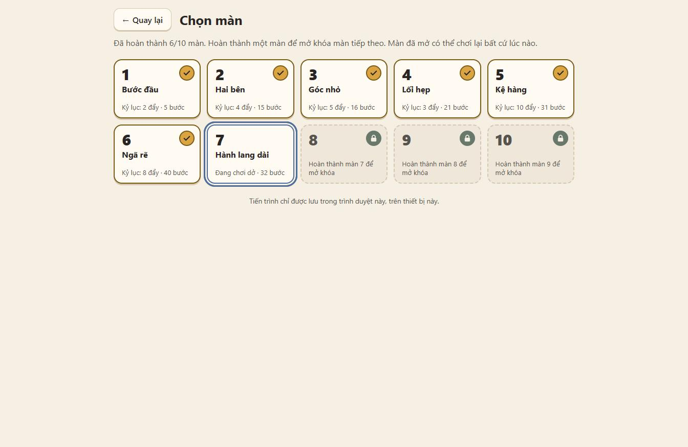

# Kho Nhỏ

An original, cozy, top-down Sokoban-style puzzle game for the web.
Push every crate onto a goal. All player-facing text is Vietnamese.

**Play:** <https://quangle2706.github.io/sokoban/>. It is deployed to GitHub
Pages automatically from `main`; see [docs/DEPLOYMENT.md](docs/DEPLOYMENT.md).

**Status: Milestone 4 (MVP complete).**
- Ten original levels with verified solutions.
- Home screen, level picker with unlocks, how-to page, and settings for
  sound, reduced motion and resetting progress.
- Sound effects are synthesized in the browser, with no audio files.
- Progress is saved in this browser, including unfinished runs with their
  undo history.
- Installable, and playable offline after the first visit.

See [docs/NEXT_STEPS.md](docs/NEXT_STEPS.md).



| Home | Gameplay | Level picker |
| ---- | -------- | ------------ |
|  |  |  |

## Requirements

- Node.js 20.19+ (developed on Node 24, which can also run the engine
  scripts directly without a build step)
- npm

## Setup and commands

```bash
npm install          # install exact pinned versions from package-lock.json
npm run dev          # dev server at http://localhost:5173
npm test             # Vitest: pure engine + level tests (no browser needed)
npm run typecheck    # tsc --noEmit
npm run build        # typecheck + production build into dist/
npm run preview      # serve the production build locally
node scripts/solve.ts                  # author tool: push-optimal search, all levels
node scripts/solve.ts --moves goc-kho  # move-optimal search for one level
node scripts/make-icons.ts             # author tool: regenerate public/icons/
```

## Controls

| Action  | Keyboard               | Touch / mouse        |
| ------- | ---------------------- | -------------------- |
| Move    | Arrow keys or W A S D  | Direction pad        |
| Undo    | Z, U or Backspace      | “Hoàn tác” button    |
| Restart | R                      | “Chơi lại” button    |
| Menu    | Esc (in game); Esc again goes back | “Menu” button   |
| Level picker | Arrow keys between cards, Enter to play | Tap a card |

Holding a direction (key or button) moves once, then repeats after 260 ms
every 140 ms.

## Stack

TypeScript · Phaser 4 (rendering only) · Vite · Vitest. No UI framework: the
HUD, buttons, screens and dialogs are plain, accessible HTML/CSS.

## Project layout

```
src/
  engine/   pure, deterministic puzzle logic (no Phaser, no DOM)
  levels/   player-facing level definitions
  scenes/   Phaser renderer behind the BoardView interface
  ui/       DOM HUD, input controller, completion dialog, Vietnamese strings
  storage/  versioned save format, pure progress rules, localStorage adapter
  audio/    synthesized sound effects (Web Audio API, no files)
  app/      App (screens, levels, saving) + GameController (input -> engine -> view)
tests/      Vitest suites + author-only solutions (tests/fixtures)
scripts/    author tools (BFS solver, icon generator)
public/     static files copied as-is: icons, manifest, service worker, _headers
.github/    CI: test + build on every push/PR, deploy main to GitHub Pages
docs/       rules, architecture, next steps
```

## Documentation

- [docs/GAME_RULES.md](docs/GAME_RULES.md) — rules, counters, level format
- [docs/ARCHITECTURE.md](docs/ARCHITECTURE.md) — module boundaries and data flow
- [docs/DEPLOYMENT.md](docs/DEPLOYMENT.md) — GitHub Pages, other hosts, offline support, release checklist
- [docs/DEMO.md](docs/DEMO.md) — demo recording shot list
- [docs/ACCESSIBILITY.md](docs/ACCESSIBILITY.md) — what was checked, and what still needs real devices
- [docs/NEXT_STEPS.md](docs/NEXT_STEPS.md) — roadmap and known limitations

## Credits

Game design, levels, code, graphics and sounds are original and generated
in code. The project uses no third-party art, audio or fonts. Dependencies:
Phaser, Vite, Vitest and TypeScript (see `package.json`).
